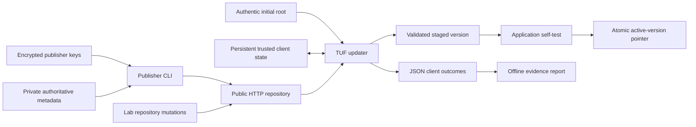

# Architecture



## Source owners

| Module | Responsibility |
| --- | --- |
| contracts.py | Signed application identity, safe path primitives, structured client outcome |
| keys.py | Encrypted PKCS8 Ed25519 private key persistence and identity checking |
| publisher.py | Authoritative metadata, prepared releases, approvals, publication and targets-key replacement |
| client.py | Official TUF client integration, retained state, application release ordering and actual decisions |
| installer.py | ZIP boundary validation, bounded extraction, self-test, activation and application launch |
| storage.py | Atomic JSON/files and process locks released by the OS on process death |
| server.py | Real loopback HTTP repository for the lab and manual demo |
| lab.py | Repeatable real-process scenarios and privileged fixture setup where explicitly noted |
| baselines.py | Local-only, intentionally incomplete artifact-acceptance comparisons |
| report.py | Escaped, self-contained presentation of recorded evidence |
| cli.py | Explicit publisher/client operations; no verification bypass |

## Publisher state and ordering

Publisher configuration, encrypted keys, pending releases and authoritative metadata live in the publisher tree. The served repository is a separate tree. Release preparation reads private state, so replacing public metadata does not cause the publisher to endorse attacker-controlled metadata on its next release.

Targets and root require two distinct signatures from three authorized keys. Snapshot and timestamp have distinct one-key roles. Approving twice with the same key still counts as one signature. The default demo keeps keys in the publisher tree. The detached workflow registers three maintainer public keys and authorizes one app and platform per repository. Maintainers check the actual artifact and exact request digest before signing. The publisher verifies each returned signature against the pending TUF metadata. Root, snapshot and timestamp keys remain with the publisher in both modes. [Detached approvals guide](APPROVALS.md)

For release publication and local release-key rotation, the publisher first signs all the required metadata and atomically saves the exact bytes in a private journal. The release artifact is already in private staging. The publisher then checks its digest, writes the hash-prefixed artifact and versioned metadata, and advances the public timestamp. It writes private state and marks the release published before removing the journal.

If the publisher process stops after saving the journal, the next release operation asks the operator to run recovery. Recovery takes the same publisher lock and repeats the writes using the same artifact digest, versions, signatures and expiration dates. It needs no signing key unlock. A successful second invocation reports `recovered: false` because the journal has been cleared. Keep the private staging directory intact until recovery completes.

```powershell
.\.venv\Scripts\python.exe -m verified_updates publisher recover --publisher .runtime/manual/publisher
```

The tested guarantee covers process interruption on a local filesystem. It assumes intact journal and staging files. First-time repository initialization, disk loss, power-loss durability and expired metadata renewal require separate handling. A client caught during key rotation can temporarily reject the old publication after seeing the new root and can retry after recovery.

## Client state and installation

The authentic bootstrap root initializes trust once. Subsequent runs load the cached current root and retain TUF metadata/history. A separate ordering file records the highest accepted application release sequence and its digest. This is distinct from TUF metadata-version rollback protection.

The client fully verifies an artifact before unpacking it. ZIP original names are checked before Python's filename normalization can obscure backslashes or NULs. Extraction rejects traversal, links, reserved Windows names, case-conflicting paths, excessive file count and excessive declared expansion. The internal manifest must match the signed application identity.

Each candidate goes into a new version directory and runs a bounded `--self-test`. Atomic replacement of `active.json` is the activation commit. A failed self-test or process exit before the commit leaves the previous pointer intact. The next attempt can accept the same already-verified release sequence/digest and retry installation. Old and orphaned directories are retained until cleanup is implemented.

The current launcher uses the local Python interpreter for a source entrypoint. It does not update the launcher itself. Portable executable support is a future format/packaging milestone.

## Evidence contracts

Each normal client result has schema version, run ID, app ID, outcome, reason code, detail, failed/completed stage, installed sequence before/after and candidate display version. Rejection and operational failure are different outcomes.

The demo records expected outcomes next to actual results. The interruption case is a separate process-level record because `os._exit(73)` deliberately prevents an ordinary client result from being written. Comparison records link to actual full-client run IDs. HTML rendering escapes diagnostics and includes no remote dependencies.

